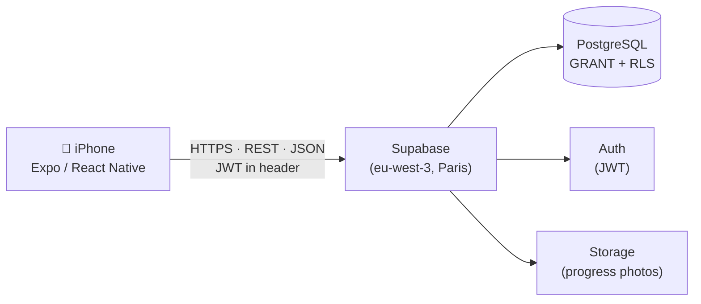
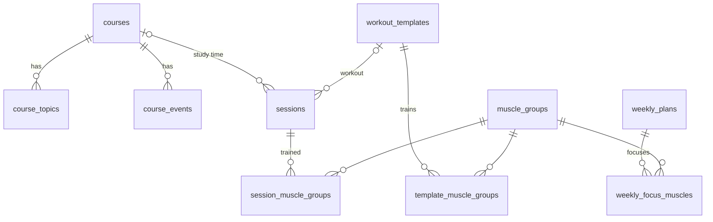

# Hipnoz

**A plan-first personal progress tracker for iPhone.** Hipnoz helps me run a demanding week — 8 university courses, 4–5 gym sessions, daily reading and a consistent sleep schedule — by planning each week up front and tracking *plan vs. actual*, instead of nagging about what was missed.

> Status: 🚧 **In development** — database layer done, mobile app next. See [Roadmap](#roadmap).

---

## Why

Keeping many goals in parallel fails less from lack of motivation than from lack of a *system*. Generic habit apps warn you after you've already slipped. Hipnoz is designed around a weekly planning ritual:

1. **Sunday:** review last week → set this week's focus (e.g. "pre-study MATH313 ch. 4", "lats + calves").
2. **During the week:** one-tap timers and check-offs log what actually happened.
3. **Weekly review:** compare plan vs. actual and feed the result into next week's plan.

## Features (V1 / MVP)

| Module | What it does |
|---|---|
| **Courses** | Topic checklist with stages (*pre-studied → attended → reviewed → practiced*), deadlines (homework, quiz, midterm, final), grade weights, study-time timer per course |
| **Workouts** | A → B → C **rotation** (not fixed weekdays), accessory-muscle pool, weekly focus areas, progress photos |
| **Reading** | Daily timer, 20 min/day target, streak |
| **Sleep** | Tap "going to sleep" / "woke up" → time-in-bed log |
| **Planning** | Weekly plan, daily checklist, fixed-time reminders, weekly review |

## Architecture



- **Client:** Expo / React Native — developed on Windows, tested on device via Expo Go.
- **Backend:** Supabase — managed PostgreSQL, authentication and object storage behind an auto-generated REST API.
- **Security:** two layers (*defense in depth*): table-level `GRANT`s for the `authenticated` role only, and **Row Level Security** so every user can only read/write their own rows.

## Data model



Key ideas:

- **One `sessions` table for every start/stop activity** (study, reading, sleep, workout, …). A new module is a new `category` value, not a new table.
- **Database-enforced rules:** a partial unique index guarantees at most **one running timer per user**; check constraints keep categories and links consistent.
- **Rotation logic:** next workout = `(last_order mod N) + 1` — a circular queue, so skipping a day never breaks the schedule.

Full schema: [`supabase/migrations/0001_initial_schema.sql`](supabase/migrations/0001_initial_schema.sql)

## Engineering decisions

Every significant decision is recorded as an [Architecture Decision Record](docs/decisions/):

| # | Decision |
|---|---|
| [0001](docs/decisions/0001-expo-react-native.md) | Expo / React Native for an iPhone app without a Mac |
| [0002](docs/decisions/0002-supabase-cloud-backend.md) | Supabase as a cloud backend from day one |
| [0003](docs/decisions/0003-region-latency.md) | Host in the EU (Paris) — latency |
| [0004](docs/decisions/0004-generic-sessions-table.md) | One generic `sessions` table for all timed activities |
| [0005](docs/decisions/0005-plan-first-rotation.md) | Plan-first design and a rotation (circular queue) for workouts |
| [0006](docs/decisions/0006-least-privilege-grant-rls.md) | Least privilege: explicit GRANTs + Row Level Security |

## Tech stack

`Expo` · `React Native` · `TypeScript` · `Supabase` · `PostgreSQL` · `Row Level Security` · `Git`

## Repository structure

```
hipnoz/
├── app/                    # Expo app (coming next)
├── docs/
│   ├── spec.md             # V1 requirements
│   └── decisions/          # ADRs
└── supabase/
    ├── migrations/         # schema, versioned
    └── seed.sql            # initial data
```

## Roadmap

- [x] Requirements & MVP scope ([spec](docs/spec.md))
- [x] Data model & schema with GRANT + RLS, tested locally
- [x] Supabase project, schema migrated, seed data loaded
- [ ] Dev environment + Expo project connected to Supabase, login screen
- [ ] First vertical slice: reading timer end-to-end
- [ ] Courses → workout rotation → sleep → weekly plan → notifications → weekly review
- [ ] TestFlight build
- [ ] V2: personal finance module (income/expenses, investments, analysis)

## Author

**Barış Karaçay** — Mathematics & Computer Engineering (double major), TED University
GitHub: [@BK707-code](https://github.com/BK707-code)
